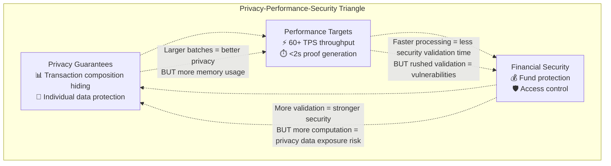
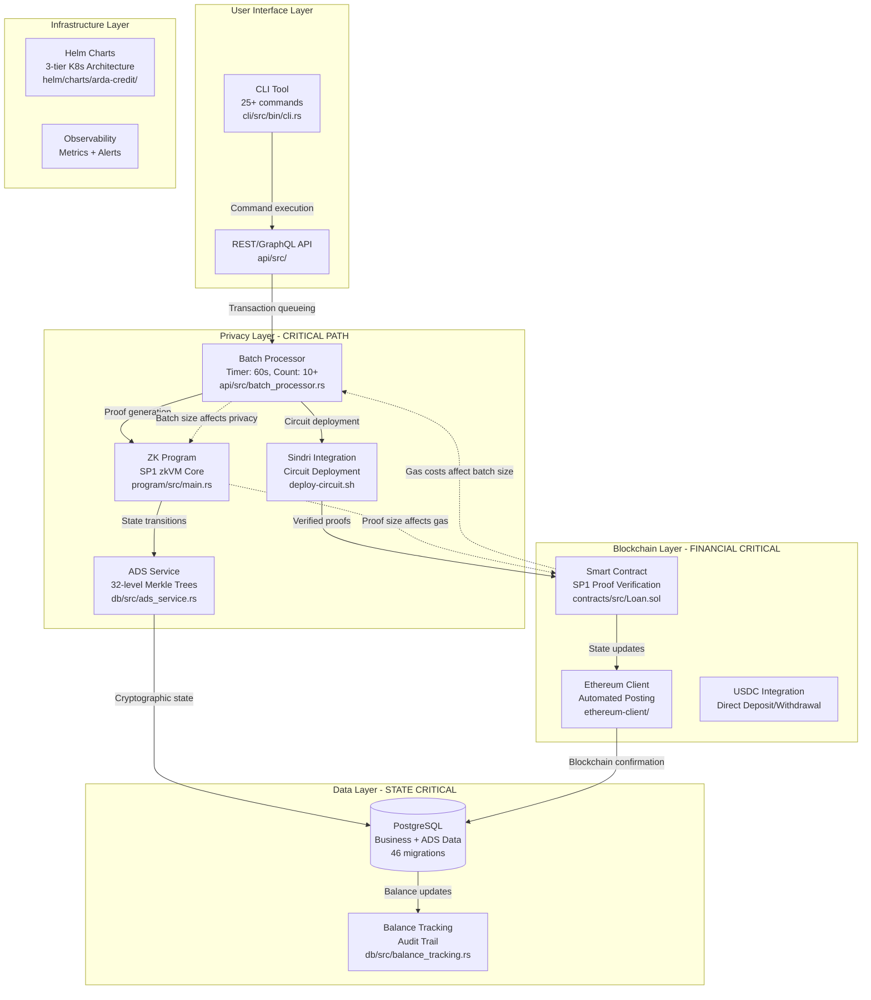
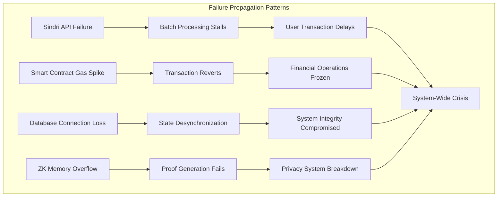

# Arda Credit Architecture Knowledge Base

This document provides bulletproof architectural understanding for all subagents. It uses multiple representation formats to capture different aspects of the system's complexity and interconnections.

## 🎯 Core Architecture Principle

**CRITICAL INSIGHT**: Arda Credit is not separate systems working together - it's a single integrated system where privacy, performance, and security are inseparably interconnected.



## 🏗️ System Architecture Overview

### Core System Flow


## 🔗 Critical Interconnection Patterns

### 1. Privacy-Performance Feedback Loop
```typescript
interface PrivacyPerformanceLoop {
  // The fundamental tension in Arda Credit
  batch_size: {
    privacy_benefit: "More transactions = better composition hiding",
    performance_cost: "More transactions = more memory + larger proofs + higher gas",
    current_optimum: "10-50 transactions per batch based on load"
  },
  
  memory_usage: {
    zk_program_limit: "SP1 zkVM memory constraints ~400MB",
    proof_size_impact: "More memory = larger proofs = higher gas costs",
    optimization_strategy: "Lazy evaluation + efficient data structures"
  },
  
  gas_optimization: {
    proof_verification_cost: "~50-100k gas per batch proof",
    batch_size_economics: "Larger batches amortize gas costs but risk timeouts",
    smart_contract_efficiency: "Minimal on-chain computation, maximum verification"
  }
}
```

### 2. State Synchronization Chain
```rust
// Critical: Any failure in this chain breaks system consistency
enum StateSyncChain {
    DatabaseWrite {
        location: "db/src/loan_operations.rs",
        triggers: "ADS nullifier generation",
        failure_impact: "Transaction lost, inconsistent state"
    },
    ADSUpdate {
        location: "db/src/ads_service.rs", 
        triggers: "ZK proof generation request",
        failure_impact: "Cryptographic state inconsistency"
    },
    ZKProofGeneration {
        location: "program/src/main.rs via Sindri",
        triggers: "Smart contract update",
        failure_impact: "Privacy system breakdown"
    },
    SmartContractUpdate {
        location: "contracts/src/Loan.sol",
        triggers: "Blockchain confirmation",
        failure_impact: "Financial state inconsistency"
    },
    EthereumConfirmation {
        location: "ethereum-client/",
        triggers: "Database balance update", 
        failure_impact: "On-chain vs off-chain divergence"
    }
}
```

### 3. Developer Workflow Interconnections
```bash
# Example: Single CLI command triggers 8-system interaction
cargo run --bin cli -- originate-loan --borrower-id abc --lender-id def --amount 50000

# System interaction chain:
# 1. CLI validation          → cli/src/bin/cli.rs
# 2. API endpoint            → api/src/loan_handlers.rs  
# 3. KYC verification        → Database user validation
# 4. Transaction creation    → db/src/loan_transactions.rs
# 5. Batch queue addition    → api/src/batch_processor.rs
# 6. ZK proof generation     → program/src/main.rs (via Sindri)
# 7. Smart contract update   → contracts/src/Loan.sol
# 8. Balance reconciliation  → db/src/balance_tracking.rs

# Failure at ANY step requires coordinated rollback across ALL systems
```

## 📊 Component Knowledge Graph

### Critical Components with Interconnection Impact
```json
{
  "critical_components": {
    "zk_program": {
      "file": "program/src/main.rs",
      "criticality": "SYSTEM_CORE",
      "failure_impact": "Complete privacy system failure",
      "interconnections": {
        "affects_directly": [
          "batch_processor (memory constraints)",
          "smart_contract (proof format)",
          "ads_service (state transitions)",
          "sindri_integration (circuit compatibility)"
        ],
        "performance_impact": {
          "memory_usage": "Affects proof size → gas costs → batch economics",
          "execution_time": "Affects throughput → batch timing → user experience",
          "proof_size": "Affects on-chain costs → financial viability"
        }
      },
      "optimization_constraints": {
        "privacy_preservation": "Cannot compromise transaction privacy for performance",
        "sp1_compatibility": "Must work within SP1 zkVM limitations",
        "gas_efficiency": "Proof size directly impacts operational costs"
      }
    },
    
    "smart_contract": {
      "file": "contracts/src/Loan.sol",
      "criticality": "FINANCIAL_CORE", 
      "failure_impact": "Potential fund loss, system trust breakdown",
      "interconnections": {
        "depends_on": [
          "zk_program (proof format compatibility)",
          "ethereum_client (deployment and interaction)",
          "sp1_verifier (external contract dependency)"
        ],
        "constrains": [
          "zk_program (proof format requirements)",
          "batch_processor (gas cost economics)",
          "usdc_integration (financial operations)"
        ]
      },
      "security_requirements": {
        "proof_verification": "Must validate SP1 proofs correctly",
        "access_control": "Only authorized operations permitted", 
        "gas_DoS_prevention": "Gas costs must be predictable and bounded",
        "upgrade_safety": "State transitions must preserve integrity"
      }
    },
    
    "batch_processor": {
      "file": "api/src/batch_processor.rs",
      "criticality": "COORDINATION_CORE",
      "failure_impact": "System throughput degradation, state desynchronization",
      "interconnections": {
        "coordinates": [
          "database (transaction queuing)",
          "zk_program (proof generation)",
          "smart_contract (batch submission)",
          "sindri (circuit interaction)"
        ],
        "optimization_balancing": {
          "privacy_vs_performance": "Batch size affects both privacy and performance",
          "latency_vs_throughput": "Timing triggers affect user experience",
          "cost_vs_speed": "Gas optimization vs proof generation time"
        }
      },
      "configuration_parameters": {
        "timer_trigger": "60 seconds (configurable)",
        "count_trigger": "10+ transactions (configurable)",
        "max_batch_size": "50 transactions (performance limited)",
        "retry_logic": "Exponential backoff for Sindri failures"
      }
    }
  }
}
```

## ⚡ Performance Interconnection Matrix

### How Changes Ripple Through the System
| Change Location | Direct Impact | Cascade Effects | Optimization Considerations |
|----------------|---------------|-----------------|---------------------------|
| **ZK Program Memory Optimization** | Smaller proofs | Lower gas costs → larger batches → better privacy → higher throughput | Must preserve privacy guarantees |
| **Smart Contract Gas Optimization** | Lower tx costs | Enables larger batches → better privacy composition → higher memory usage | Balance gas vs ZK memory |
| **Batch Size Increase** | Better privacy | Higher memory usage → larger proofs → higher gas costs → potential timeouts | Find optimal batch size sweet spot |
| **Database Query Optimization** | Faster batch creation | Higher throughput → more frequent proof generation → more Sindri load | Monitor external service limits |
| **Infrastructure Scaling** | More resources | Enables parallel processing → higher throughput → more complex state coordination | Ensure state consistency |

## 🚨 Critical Failure Scenarios & Interconnection Impacts

### Failure Cascade Analysis


## 🎯 Agent-Specific Architecture Views

### Systems Architect View
**Focus**: Technical interconnections, performance optimization, security implications
- Understands ZK ↔ Smart Contract ↔ Infrastructure integration patterns
- Optimizes across privacy-performance-security triangle
- Handles cross-system debugging and architecture decisions

### Developer Experience Engineer View  
**Focus**: Workflow interconnections, tooling integration, developer productivity
- Understands CLI ↔ API ↔ Testing ↔ Deployment workflow chains
- Optimizes developer experience across complex system interactions
- Ensures tooling supports the underlying technical complexity seamlessly

### Feature Orchestrator View
**Focus**: Business feature to technical system mapping, coordination patterns
- Understands how business requirements map to multi-system implementations
- Coordinates work across agents when features span multiple domains
- Manages complexity for stakeholders while ensuring technical integrity

## 🛡️ Architectural Invariants (Never Break These)

1. **Privacy Invariant**: Individual loan amounts, user details, and KYC status NEVER appear in public values
2. **Consistency Invariant**: Database ↔ ZK ↔ Smart Contract state ALWAYS synchronized
3. **Security Invariant**: All financial operations require KYC verification + cryptographic proof
4. **Performance Invariant**: System maintains 60+ TPS under normal load conditions
5. **Auditability Invariant**: All state transitions are cryptographically verifiable and logged

This architecture knowledge ensures all agents understand not just their domain, but how their domain interconnects with and affects the entire Arda Credit system.