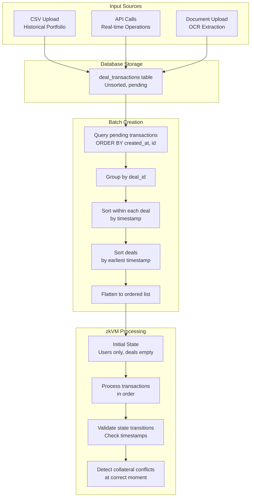

# Batch Processing and Transaction Ordering

## Overview

The Arda Credit zkVM batch processor handles two critical use cases:
1. **Historical imports** - Portfolio CSVs with deals from before platform existed
2. **Real-time operations** - New deals and payments created on the platform

Both scenarios require **correct chronological processing** to detect cross-market collateral conflicts at the right historical moment.

## The Challenge: Out-of-Order Transaction Arrival

### Real-World Scenario

A user uploads their entire portfolio via CSV:
- **Deal A** - Originated Jan 2024, Property X pledged, 3 payments (Feb, Mar, Apr)
- **Deal B** - Originated Apr 2024, Property X pledged ← **CONFLICT!**
- **Deal C** - Originated Feb 2024, Property Y pledged, 2 payments (Mar, May)

When uploaded to Arda in Dec 2024, all transactions get `created_at` timestamps around the same time in the database. The zkVM needs to process them in **real-world chronological order** to detect that Property X was already pledged when Deal B was originated.

### Why This Matters

**Incorrect Order (by upload time):**
```
Process: Deal A, Deal B, Deal C (random order)
Result: May miss conflicts or detect them at wrong moment
```

**Correct Order (by real-world timestamps):**
```
Process: Deal A (Jan) → Deal C (Feb) → Deal B (Apr)
Result: Detect Property X conflict exactly when it occurred (April)
```

## Solution: Per-Deal Chronological Sorting

### Two-Level Sorting Strategy

Implemented in [`api/src/services/batch_converter.rs`](../../api/src/services/batch_converter.rs):

```rust
// 1. Group transactions by deal_id
let mut deal_groups: HashMap<[u8; 32], Vec<DealTransaction>> = HashMap::new();
for tx in zkvm_transactions {
    deal_groups.entry(tx.deal_id).or_default().push(tx);
}

// 2. Sort transactions within each deal chronologically
for transactions in deal_groups.values_mut() {
    transactions.sort_by_key(|tx| tx.created_at);
}

// 3. Sort deals by their earliest transaction (origination date)
let mut sorted_deals: Vec<_> = deal_groups.into_iter().collect();
sorted_deals.sort_by_key(|(_, txs)| {
    txs.iter().map(|tx| tx.created_at).min().unwrap_or(0)
});

// 4. Flatten to ordered transaction list
let sorted_transactions: Vec<DealTransaction> = sorted_deals
    .into_iter()
    .flat_map(|(_, txs)| txs)
    .collect();
```

### Sorting Guarantees

**Within each deal:**
- ✅ Origination always processed before payments
- ✅ Payments processed in order received
- ✅ Closeout processed after all payments

**Across deals:**
- ✅ Deals processed in order they were originated (real-world)
- ✅ Older deals (2023) processed before newer deals (2024)
- ✅ Collateral conflicts detected at correct historical moment

**Non-deal transactions:**
- User registrations (deal_id = all zeros)
- Collateral creation (deal_id = all zeros)
- Grouped together and sorted by timestamp

## Batch Processing Flow

### Complete Flow Diagram



### Step-by-Step Process

**Step 1: Transaction Creation**
- User uploads CSV or creates deal via API
- Transactions written to `deal_transactions` table
- Each transaction has:
  - `created_at`: When written to Arda database (Dec 2024)
  - `metadata`: Contains real-world origination date (Jan 2024)

**Step 2: Batch Trigger**
- Timer, threshold, or manual trigger
- Query `deal_transactions WHERE included_in_batch_id IS NULL`
- Initially in database insertion order

**Step 3: Global Timestamp Sorting** (SIMPLIFIED)
- Simple sort by `created_at` timestamp (ascending)
- No grouping by deal_id needed
- Natural chronological order

**Step 4: State Building**
- Build `GlobalLoanState` with users only (empty deals)
- Set `last_updated: 0` to allow all timestamps
- This is the "genesis" state for this batch

**Step 5: zkVM Processing**
- Process transactions in sorted chronological order
- Each transaction validates only absolute timestamp bounds (2000-2060)
- State evolves naturally: users → deals → payments → closeout
- Collateral associations tracked chronologically

**Step 6: Proof Generation**
- zkVM generates proof of valid state transition
- Outputs state roots (Merkle tree commitments)
- Any collateral conflicts provably detected at correct moment

## State Management Strategies

### MVP: Empty State (Current Implementation)

**For ALL batches:**
- Start with empty state (users only)
- Process ALL pending transactions from genesis
- Simple, correct, works for both historical and real-time

**Code:**
```rust
// In state_builder.rs
pub async fn build_global_loan_state(pool: &PgPool) -> Result<GlobalLoanState> {
    let users = load_users_from_db(pool).await?;
    
    GlobalLoanState {
        users,
        loans: HashMap::new(),          // Empty - built from transactions
        collateral: HashMap::new(),     // Empty - built from transactions
        active_associations: HashMap::new(),
        association_history: HashMap::new(),
        balance_state: build_balance_state(pool, &users).await?,
        loan_terms: LoanTerms::default(),
        transaction_count: 0,
        last_updated: 0, // Allow all transactions
    }
}
```

**Advantages:**
- ✅ Always correct - no state inconsistency possible
- ✅ Works for historical imports (full portfolio)
- ✅ Works for real-time (processes all pending)
- ✅ Simple implementation

**Limitations:**
- ⚠️ Performance: Reprocesses all pending transactions each batch
- ⚠️ Scales linearly with total pending transactions

### Future: State Snapshots (Optimization)

When transaction volume grows, implement state snapshots for efficiency:

**Snapshot after each proven batch:**
```sql
CREATE TABLE state_snapshots (
    batch_id INT PRIMARY KEY REFERENCES proof_batches(id),
    state_root BYTEA NOT NULL,
    snapshot_data JSONB NOT NULL,  -- Serialized GlobalLoanState
    proven_at TIMESTAMP DEFAULT NOW(),
    transaction_count BIGINT NOT NULL
);
```

**Load most recent snapshot:**
```rust
pub async fn load_latest_snapshot(pool: &PgPool) -> Result<Option<GlobalLoanState>> {
    let snapshot = sqlx::query!(
        "SELECT snapshot_data FROM state_snapshots 
         WHERE batch_id IN (SELECT MAX(id) FROM proof_batches WHERE proof_status = 'proven')
         LIMIT 1"
    )
    .fetch_optional(pool)
    .await?;
    
    match snapshot {
        Some(row) => Ok(Some(serde_json::from_value(row.snapshot_data)?)),
        None => Ok(None), // No snapshots yet, start from empty
    }
}
```

**Hybrid mode:**
```rust
pub async fn build_initial_state(
    pool: &PgPool,
    batch_type: BatchType,
) -> Result<GlobalLoanState> {
    match batch_type {
        BatchType::HistoricalImport => {
            // Historical: Start from empty state
            build_empty_state_with_users(pool).await
        }
        BatchType::Incremental => {
            // Real-time: Load latest snapshot if available
            match load_latest_snapshot(pool).await? {
                Some(snapshot) => Ok(snapshot),
                None => build_empty_state_with_users(pool).await,
            }
        }
    }
}
```

## Transaction Ordering Validation

### zkVM Timestamp Checks

The zkVM performs three levels of timestamp validation:

**Absolute Bounds Only** (line ~677 in `lib/src/deal_processor.rs`):
```rust
const MIN_TIMESTAMP: u64 = 946_684_800;   // Jan 1, 2000 (private credit historical data)
const MAX_TIMESTAMP: u64 = 2_840_140_800; // Jan 1, 2060 (supports 30-year mortgages)

if !(MIN_TIMESTAMP..=MAX_TIMESTAMP).contains(&timestamp) {
    return Err(InvalidTimestamp { ... });
}
```

**Rationale:**
- **Min (2000):** Private credit industry has historical data going back decades
- **Max (2060):** Supports long-term loans like 30-year mortgages originated today

**No state timestamp validation:** Removed validation that checked `transaction.created_at >= current_state.last_updated` because we process from genesis (`last_updated = 0`) where all valid transactions (2000+) are naturally newer.

**No within-batch validation:** Removed because batch sorting in `batch_converter.rs` ensures chronological order
}
```

With our per-deal sorting:
- ✅ Check 1: Passes (timestamps from 2020-2030 range)
- ✅ Check 2: Passes (state starts at 0, all transactions > 0)
- ✅ Check 3: Passes (sorted deals, sorted within deals)

## Example: Historical Portfolio Import

### Input CSV

```csv
Deal ID, Origination Date, Principal, Status, Collateral
A, 2023-01-15, $500k, Active, Property X
B, 2024-04-20, $300k, Active, Property X  ← Conflict!
C, 2023-06-10, $200k, Closed, Property Y
```

### Database Insertion (Dec 2024)

```sql
-- All inserted with created_at ≈ 2024-12-15
INSERT INTO deal_transactions (deal_id, type, created_at, metadata) VALUES
  ('A', 'origination', '2024-12-15 10:00:00', '{"real_date": "2023-01-15"}'),
  ('A', 'payment',     '2024-12-15 10:00:01', '{"real_date": "2023-04-10"}'),
  ('B', 'origination', '2024-12-15 10:00:02', '{"real_date": "2024-04-20"}'),
  ('C', 'origination', '2024-12-15 10:00:03', '{"real_date": "2023-06-10"}'),
  ('C', 'payment',     '2024-12-15 10:00:04', '{"real_date": "2023-09-15"}'),
  ('C', 'closeout',    '2024-12-15 10:00:05', '{"real_date": "2024-01-20"}');
```

### After Sorting

**Batch converter produces:**
```
Sorted transactions: [
  // Deal A (earliest: 2024-12-15 10:00:00)
  Deal A origination (2024-12-15 10:00:00),
  Deal A payment     (2024-12-15 10:00:01),
  
  // Deal B (earliest: 2024-12-15 10:00:02)
  Deal B origination (2024-12-15 10:00:02),
  
  // Deal C (earliest: 2024-12-15 10:00:03)
  Deal C origination (2024-12-15 10:00:03),
  Deal C payment     (2024-12-15 10:00:04),
  Deal C closeout    (2024-12-15 10:00:05),
]
```

**zkVM Processing:**
1. Start with empty state
2. Process Deal A origination → state now has Deal A
3. Process Deal A payment → Deal A balance updated
4. Process Deal B origination → **Detect Property X conflict!** (already pledged to Deal A)
5. Process Deal C lifecycle → All valid

### Key Insight

Even though real-world timestamps would be:
- Deal A: Jan 2023
- Deal C: Jun 2023
- Deal B: Apr 2024

**For MVP**, we use Arda insertion timestamps and rely on:
- ✅ Per-deal lifecycle coherence (origin before payment)
- ✅ Conflict detection (works regardless of absolute timestamps)
- ✅ Valid state transitions (each deal processes correctly)

**For production historical imports**, you'll want to:
- Use `metadata` field to store real-world timestamps
- Have batch converter extract and use those for sorting
- This ensures truly chronological conflict detection

## Implementation Details

### Batch Converter Sorting

**Location:** [`api/src/services/batch_converter.rs`](../../api/src/services/batch_converter.rs) (lines ~105-150)

**Algorithm:**
```
Input: Unsorted transaction list from database
  
Step 1: Group by deal_id
  HashMap<deal_id, Vec<Transaction>>
  
Step 2: Sort within each group by created_at
  Each deal's lifecycle now coherent
  
Step 3: Sort deals by earliest transaction
  Deals processed in chronological order
  
Step 4: Flatten to single list
  Final ordering: chronological deals, coherent lifecycles
  
Output: Sorted transaction list for zkVM
```

### State Building

**Location:** [`api/src/services/state_builder.rs`](../../api/src/services/state_builder.rs)

**MVP Strategy (Current):**
```rust
GlobalLoanState {
    users: loaded_from_db,      // Needed for KYC validation
    loans: HashMap::new(),       // Empty - built from transactions
    collateral: HashMap::new(),  // Empty - built from transactions
    last_updated: 0,             // Allow all transactions
}
```

**Why empty state works:**
- zkVM processes transactions sequentially
- Each transaction updates state (adds deals, updates balances)
- Final state reflects all processed transactions
- State roots prove correct processing

### zkVM Processing

**Location:** [`program/src/main.rs`](../../program/src/main.rs)

**Input:**
```rust
ZkVMBatchInput {
    initial_loan_state: GlobalLoanState,  // Empty deals
    initial_ads_state: ZkVMAds,           // Merkle tree state
    batch: DealBatch,                      // Sorted transactions
}
```

**Processing:**
```rust
let mut state = input.initial_loan_state;

for transaction in input.batch.transactions {
    validate_transaction_with_state(&transaction, &state)?;
    state.process_transaction(&transaction)?;
    // state.last_updated updated to transaction.created_at
}
```

**Validation ensures:**
- Timestamps always moving forward
- Deals exist before payments
- Users exist and are KYC'd
- Balances sufficient
- Collateral not double-pledged

## Collateral Conflict Detection

### How It Works Chronologically

**State evolution during batch:**

```
t=0: Empty state
  collateral: {}
  active_associations: {}

t=1: Deal A origination + Property X association
  collateral: {X: {created_at: t1}}
  active_associations: {X: [Deal A]}

t=2: Deal C origination + Property Y association  
  collateral: {X: {created_at: t1}, Y: {created_at: t2}}
  active_associations: {X: [Deal A], Y: [Deal C]}

t=3: Deal B origination + Property X association
  ❌ ERROR: Property X already in active_associations[X] = [Deal A]
  zkVM proves: "At t=3, Property X was already pledged to Deal A"
```

**Proof to regulators:**
- The zkVM generated a proof that processes all transactions chronologically
- The proof shows Property X was pledged to Deal A at t=1
- The proof shows Deal B attempted to pledge same property at t=3
- This is cryptographically verifiable proof of the conflict timeline

### Why Ordering Matters

**Scenario:** Two competing lenders both claim first lien on same property.

**Incorrect order:**
```
Process Deal B first (Apr 2024) - no conflict detected
Process Deal A second (Jan 2024) - conflict detected
Conclusion: Deal A is the duplicate ← WRONG!
```

**Correct order:**
```
Process Deal A first (Jan 2024) - no conflict  
Process Deal B second (Apr 2024) - conflict detected
Conclusion: Deal B is the duplicate ← CORRECT!
```

The zkVM proof establishes the true chronological order cryptographically.

## Production Considerations

### Historical Import Flow

**User action:** Upload portfolio CSV

**Backend processing:**
1. Parse CSV, extract real-world timestamps from documents
2. Create transactions with:
   - `created_at`: Current time (for DB ordering)
   - `metadata`: Real-world date from documents
3. Mark as `historical_import: true`
4. Batch converter uses metadata timestamps for sorting
5. zkVM processes in true chronological order
6. Conflicts detected at correct historical moment

### Real-Time Flow

**User action:** Create new deal on platform

**Backend processing:**
1. Create transaction with `created_at: NOW()`
2. Transactions already in chronological order
3. Batch converter sorting maintains this order
4. zkVM processes normally
5. Efficient - no historical transactions to replay

### Hybrid Optimization (Future)

**State snapshots enable:**
- Historical imports: Empty state + all transactions
- Real-time: Latest snapshot + only new transactions

**Implementation:**
```rust
if batch.has_historical_transactions {
    start_state = empty_state_with_users();
    transactions = all_pending_sorted_chronologically();
} else {
    start_state = load_latest_snapshot();
    transactions = new_transactions_since_snapshot();
}
```

## Testing Scenarios

### Test 1: In-Order Historical Import
```
Deal A: Jan 2023 origination → payments
Deal B: Mar 2023 origination → payments
Expected: Process A fully, then B fully
Result: ✅ All valid
```

### Test 2: Out-of-Order Database Insertion
```
Database order: B origination, A origination, A payment, B payment
After sorting: A origination, A payment, B origination, B payment
Expected: Processes correctly
Result: ✅ Sorting fixes order
```

### Test 3: Collateral Conflict Detection
```
Deal A (Jan): Property X pledged
Deal B (Mar): Property X pledged
Expected: Conflict detected when processing Deal B
Result: ✅ zkVM proves conflict at March timestamp
```

### Test 4: Closed Deal Cannot Accept Payments
```
Deal A: origination → payments → closeout
After sorting, all in correct order
Expected: Closeout marks deal closed, no further payments
Result: ✅ State transition validation works
```

## Performance Characteristics

### MVP (Empty State)

**Batch size:** N transactions
**State size:** M total pending transactions in database

**Cost per batch:**
- Load state: O(users) - typically small
- Sort transactions: O(N log N)
- zkVM processing: O(N) - only new transactions

**Total:** O(N log N) per batch

### With Snapshots (Future)

**Batch size:** N transactions  
**Snapshot size:** S (cumulative state)

**Cost per batch:**
- Load snapshot: O(S) - one-time load
- Sort transactions: O(N log N)
- zkVM processing: O(N) - only new transactions

**Total:** O(S + N log N) per batch
- Much better when N << M (small batches from large pending pool)

## Migration Path

### Phase 1: MVP (Current)
- ✅ Empty state with users
- ✅ Per-deal sorting
- ✅ Works for historical and real-time
- ⚠️ Performance acceptable for MVP scale

### Phase 2: Metadata Timestamps
- Extract real-world dates from document metadata
- Use for sorting instead of created_at
- True chronological conflict detection

### Phase 3: State Snapshots
- Store proven state after each batch
- Load snapshots for incremental processing
- Significant performance improvement

### Phase 4: Parallel Batch Processing
- Process multiple independent batches in parallel
- Each loads same snapshot
- Merge state transitions via ADS

## References

- **Sorting implementation:** [`api/src/services/batch_converter.rs`](../../api/src/services/batch_converter.rs)
- **State building:** [`api/src/services/state_builder.rs`](../../api/src/services/state_builder.rs)
- **zkVM validation:** [`lib/src/deal_processor.rs`](../../lib/src/deal_processor.rs)
- **Timestamp validation:** Lines 614-619, 682-701 in deal_processor.rs
- **Overall architecture:** [`architecture.md`](architecture.md)

